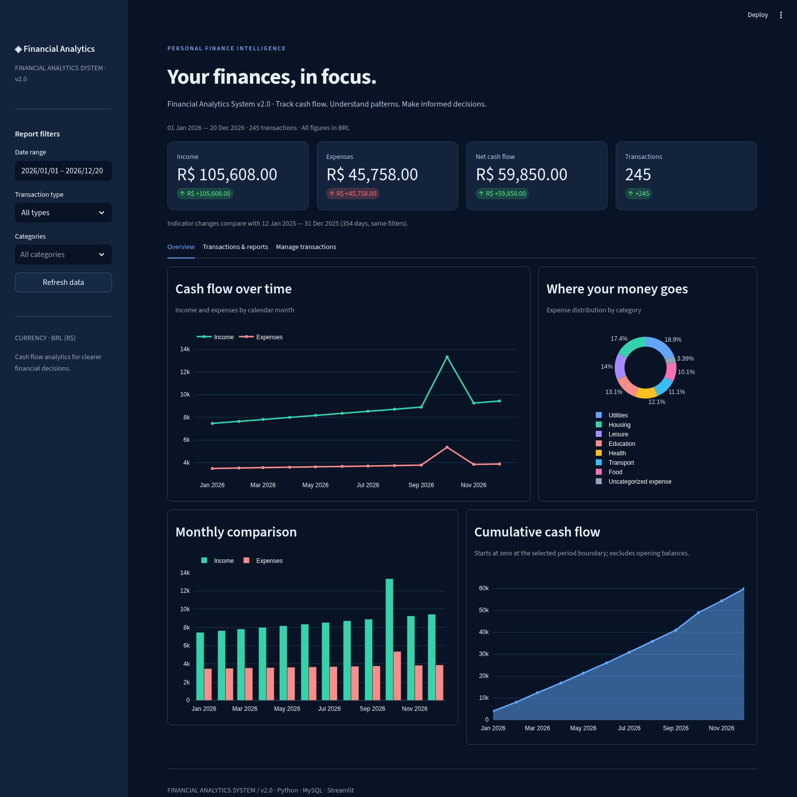
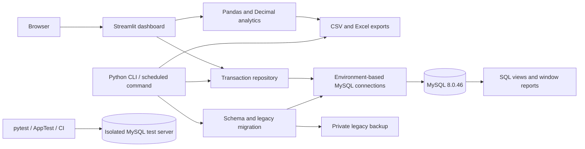
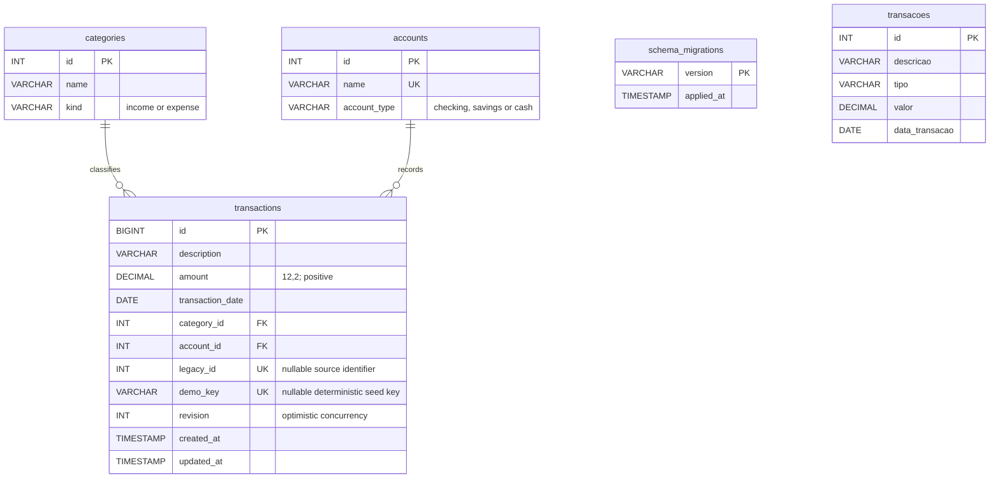

# Financial Analytics System v2.0

A practical financial analytics application built with Python and MySQL. It turns a small SQL learning project into a modular portfolio application with a normalized database, reproducible demo data, interactive reporting, transaction management, and automated verification against a real MySQL server.

The project demonstrates SQL analytics, exact monetary calculations, data migration, report automation, and application development. All amounts use **Brazilian reais (BRL)**.



## Features

- Interactive Streamlit dashboard with a dark blue theme and responsive layouts.
- Income, expenses, net cash flow, and transaction count indicators.
- Monthly trends, expense categories, monthly comparisons, and cumulative cash flow.
- Inclusive date, category, and transaction type filters shared by charts, tables, and exports.
- Transaction creation, editing, and confirmed deletion, with optimistic concurrency checks.
- CSV and Excel exports, including a command-line interface for scheduled reporting.
- Additive legacy migration with a private backup, reconciliation, and transactional imports.
- Optional **240 deterministic demo transactions**, 20 per month throughout 2026.
- MySQL reports using JOINs, CTEs, window functions, views, conditional aggregation, and `HAVING`.
- Unit tests, real MySQL integration tests, Streamlit interaction tests, and GitHub Actions CI.

## Technology stack

| Component | Technology |
| --- | --- |
| Language | Python 3.12 |
| Database | **MySQL 8.0.46**, InnoDB, utf8mb4 |
| Data access | mysql-connector-python; parameterized SQL |
| Analytics | SQL, Pandas, Python `Decimal` |
| Dashboard | Streamlit, Plotly |
| Reports | CSV, openpyxl / Excel |
| Quality | pytest, Ruff, Streamlit AppTest |
| Execution | Docker Compose, VS Code Dev Containers, GitHub Actions |

Direct Python dependencies are pinned in `requirements.txt` and `requirements-dev.txt`.

## Architecture



The dashboard delegates persistence to the repository and financial calculations to the analytics module. Each database operation opens a short-lived connection, commits on success, rolls back on failure, and closes the connection. Database errors shown to users exclude SQL values and credentials.

```text
app.py                       Streamlit entry point
financial_analytics/
  config.py                  Environment configuration
  db.py                      Connections, rollback, sanitized errors, logging
  validation.py              Input and Decimal validation
  repository.py              Parameterized CRUD and filters
  analytics.py               Exact totals, monthly and cumulative cash flow
  exports.py                 CSV and Excel generation
  migrations.py              Additive schema, legacy import, deterministic seed
  cli.py                     Initialization and automated report exports
sql/001_schema.sql           Tables, constraints, indexes and views
03_relatorios.sql            Executable analytical SQL examples
scripts/                     Private environment setup and isolated legacy staging
.devcontainer/               Isolated development configuration
.streamlit/                  Dashboard theme
tests/                       Unit, MySQL integration and dashboard tests
```

## Database schema



The original `transacoes` table is retained as a historical source and is never modified by the initializer. `legacy_id` records provenance without coupling future CRUD operations to the frozen source. Categories own the transaction type, so it is not duplicated in transactions. Category names are unique within a type; account names are unique. Foreign keys restrict deletion of referenced categories and accounts. Checks enforce positive amounts, valid types, nonblank descriptions, and positive revisions. Date and composite category/account date indexes support filtering.

`v_transaction_details` joins transactions, categories, and accounts and derives signed amounts. `v_monthly_summary` fills missing calendar months and uses `SUM OVER` and `LAG` for cumulative cash flow and previous-month comparisons. The monthly SQL view uses MySQL's default recursive CTE limit (1,000 iterations); for histories exceeding 83 years, increase the session limit before querying that view.

## Installation

### Docker Compose (recommended)

Requirements: Git, Python 3.12 for the helper scripts, Docker Engine/Desktop, and Docker Compose v2.24.4 or later.

```bash
git clone https://github.com/Lpinheirowvski/sistema-controle-financeiro.git
cd sistema-controle-financeiro
python scripts/setup_env.py
docker compose build app
docker compose up -d --wait db
```

The helper creates a private `.env` with separate randomly generated administrator, migration, and application passwords. It refuses to overwrite an existing file. Alternatively, copy `.env.example` to `.env` and replace every placeholder password.

For a **new installation**, initialize the schema and optional demo data:

```bash
docker compose run --rm migrate python -m financial_analytics.cli init --seed
docker compose up -d --wait app
```

Open **http://localhost:8501**. Omit `--seed` for an empty application. Repeating initialization does not duplicate imports or demo data, overwrite edited demo transactions, or restore deleted demo transactions. Initialization is explicit and is not run every time the dashboard refreshes.

MySQL has **no published host port**. The application and migration service use the database service name `db` on an internal network. The browser port binds to localhost. The runtime account has database-scoped `SELECT`, `INSERT`, `UPDATE`, and `DELETE`; the separate migration account owns schema changes.

```bash
docker compose stop                  # Stop without deleting stored data
docker compose logs app              # Inspect application logs
```

The named `mysql_data` volume persists data. Keep it and your `.env` when restarting. Changing `.env` passwords does not rotate users inside an already initialized MySQL volume; coordinate password rotation with an administrator. The initial user provisioning script runs only for new volumes.

### Migrate the existing isolated Docker database

Stop legacy writers first. Keep the original container and its storage intact. After building the app and starting the **new** Compose `db`, but before initialization:

```bash
python scripts/stage_legacy.py --source-container financeiro-mysql
docker compose run --rm migrate python -m financial_analytics.cli init --seed
docker compose up -d --wait app
```

The staging helper reads `transacoes` with `docker exec` and `mysqldump --single-transaction`, without attaching the source container to a network. It creates a private SQL backup in `backups/` and refuses to overwrite any existing destination `transacoes` table. For a password-protected source, supply `LEGACY_MYSQL_PASSWORD` through the environment; do not put it in shell command arguments. `--source-database` selects a different source database.

The Python initializer then:

1. Acquires a database-specific advisory lock to serialize initialization.
2. Creates additive v2 tables and views. MySQL DDL commits independently; source tables stay intact.
3. Reads and locks the legacy source, creates an atomic JSON backup with a SHA-256 identifier, and validates every row.
4. Imports each source ID once into an uncategorized income or expense category and the `Legacy account`.
5. Verifies row counts and monetary totals, then commits imported rows and the migration marker together.
6. Adds demo data only when requested, with a separate migration marker and unique seed keys.

Invalid source rows or a backup failure abort the import. Rows are never silently dropped, rounded, or skipped. A failed DML import rolls back, and the source plus backup remain available for investigation. Empty source tables are marked as imported; stop legacy writes permanently after migration. For a populated source discovered later, rerun initialization only if no legacy import marker has been recorded.

JSON snapshots are stored in the private `migration_backups` Docker volume. They contain sensitive financial data and are not committed. The one-off migration container is removed by `--rm`. To retrieve snapshots from the persistent backup volume, use:

```bash
mkdir -p backups
docker compose run --rm --entrypoint tar migrate -C /app/backups -cf - . > backups/migration-backups.tar
chmod 600 backups/migration-backups.tar
```

Restrict access to that archive. For operational recovery, keep a complete database dump as well. To roll back the application migration, stop the v2 app and return to the unchanged legacy source; new v2 edits are not synchronized back automatically. Restore backups into a separate database and verify counts before switching applications.

The retained `01_estrutura.sql` and idempotent `02_dados.sql` reproduce the original five-row example for learning. They are not the v2 startup path. The original `relatorio_financeiro.csv` is retained as a historical example.

### Python or VS Code development

For an existing reachable MySQL **8.0.46** database:

```bash
python -m venv .venv
source .venv/bin/activate             # Windows: .venv\Scripts\activate
pip install -r requirements-dev.txt
# Configure DB_HOST, DB_PORT, DB_NAME, DB_USER, DB_PASSWORD in .env.
# Use a migration account for initialization, then a CRUD account for the dashboard.
python -m financial_analytics.cli init --seed
streamlit run app.py
```

The database must already exist. For remote connections, set `DB_SSL_CA` to your trusted CA file; this enables certificate and hostname verification. The Compose database is intentionally inaccessible directly from the host; execute Python inside Compose or use the included Dev Container.

Generate `.env`, then select **Dev Containers: Reopen in Container** in VS Code. The development container uses a separate temporary MySQL server on the internal `testing` network, initializes demo data, and runs the test suite. It does not connect to the preserved legacy database. Run `streamlit run app.py --server.address=0.0.0.0` inside it and use the forwarded port 8501. Development database storage is temporary; use the main Compose stack for persistent records.

For managed environments with a private proxy CA, the Dockerfile accepts an optional BuildKit secret. Keep certificate verification enabled:

```bash
docker build --secret id=proxy_ca,src=/path/to/trusted-ca-bundle.pem \
  --target base -t financial-analytics:local .
```

## Usage examples

Use the sidebar to select a period, type, or categories. The **Overview** tab shows financial indicators and charts. **Transactions & reports** provides a sortable, searchable table and exports. **Manage transactions** contains creation and editing forms and requires confirmation before deletion. Transaction type follows the selected category.

Amounts are validated to two decimal places using `Decimal`; SQL uses `DECIMAL(12,2)`. Only plotting converts values to floating point. Date filters include both endpoints. Cumulative net starts at zero at the selected period boundary and excludes opening balances. Indicator deltas compare the same number of calendar days immediately before the selected period, using the same category/type filters. The SQL monthly view compares consecutive calendar months, including empty months.

Automate exports with the CLI:

```bash
docker compose exec app python -m financial_analytics.cli export \
  --start 2026-01-01 --end 2026-12-31 --output /tmp/reports
mkdir -p reports
docker compose cp app:/tmp/reports/. reports/
```

The CLI writes `transactions.csv` and `financial-report.xlsx`. The workbook contains transactions and a monthly summary. Text that could be interpreted as a spreadsheet formula is escaped in both export formats. The CLI can be invoked from an operating system scheduler; no scheduler runs automatically.

Parameterized CRUD can also be used directly:

```python
from datetime import date
from financial_analytics.repository import Filters, TransactionRepository
from financial_analytics.validation import TransactionInput

repo = TransactionRepository()
category = next(c for c in repo.categories() if c['kind'] == 'expense')
account = repo.accounts()[0]
item = TransactionInput.parse('Internet service', '149.90', date(2026, 11, 1),
                              category['id'], account['id'])
transaction_id = repo.create(item)
row = repo.get(transaction_id)
repo.update(transaction_id, item, row['revision'])
rows = repo.list(Filters(date(2026, 11, 1), date(2026, 11, 30), kind='expense'))
# Delete only when intended, using the current revision:
# repo.delete(transaction_id, repo.get(transaction_id)['revision'])
```

Run the checked-in SQL analytics:

```bash
docker compose exec -T db sh -c \
  'MYSQL_PWD="$MYSQL_ROOT_PASSWORD" mysql -uroot "$MYSQL_DATABASE"' < 03_relatorios.sql
```

The script explicitly selects `controle_financeiro`. If you customized `DB_NAME`, change that `USE` statement before running this standalone report. Python and the dashboard already use `DB_NAME`.

## Testing

Unit checks without a running database:

```bash
pip install -r requirements-dev.txt
ruff check .
ruff format --check .
pytest -m 'not integration' -q
```

Complete tests on an isolated MySQL server, without exposing a database port:

```bash
docker compose --profile test build tests
docker compose --profile test run --rm tests
```

The test service connects only to `db-test` on the internal `testing` network. Fixtures require `RUN_MYSQL_TESTS=1` and a configured database name ending in `_test`. Each fixture creates a uniquely named database and drops only that database on cleanup. Test data never targets the production schema. Without the opt-in, integration tests are explicitly skipped, not counted as successful execution.

The suite covers input validation, configuration safety, Decimal totals, empty periods, missing-month comparisons, formula-safe exports, real SQL report execution, constraints, CRUD, stale updates/deletions, migration reconciliation, rollback, backup permissions, seed idempotence, and dashboard interactions. GitHub Actions runs the suite with MySQL **8.0.46**, lint, formatting, configuration validation, and a Docker startup check.

See [validation notes](docs/VALIDATION.md) for actual checks and outcomes from this implementation. Screenshots are captures of the running application, not design mockups.

## Screenshots

- [Desktop overview](docs/screenshots/dashboard-desktop.png)
- [Transaction ledger](docs/screenshots/transaction-ledger.png)
- [Mobile overview](docs/screenshots/dashboard-mobile.png)

## Current scope and future improvements

This is a local portfolio application with no authentication or authorization UI. The default Compose port binds to localhost. Add authentication, user-level authorization, HTTPS hosting, and operational backups before any shared deployment.

Planned improvements, **not implemented**: account/category management screens, recurring transaction rules, bank statement import, budgets, multi-currency accounting, audit history, database-side pagination for large ledgers, and scheduled background jobs. The current dataset loads into memory for analysis; it is intended for personal and small-business portfolio demonstrations.
